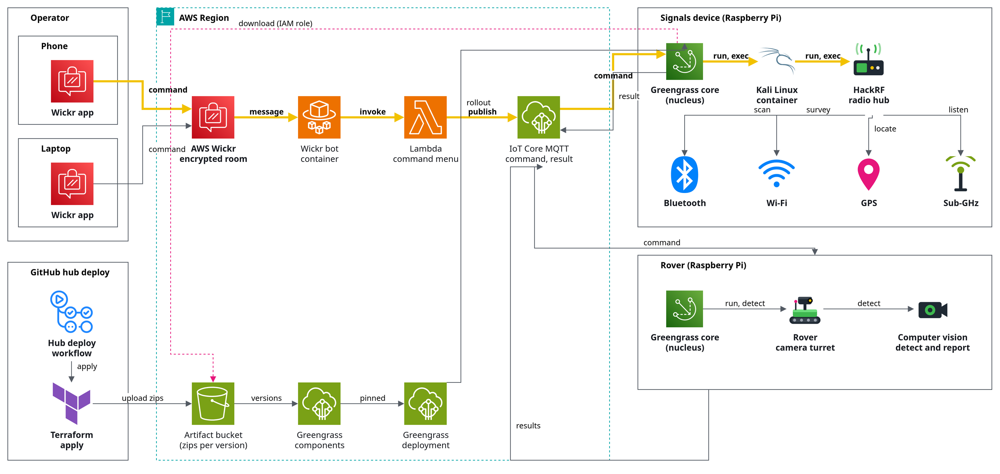

# Specter Edge

## Executive summary

Specter Edge lets an operator run field tasks on remote devices from a chat window. You type a command in the  [AWS Wickr](https://aws.amazon.com/wickr/) app on a phone or laptop, a message travels through  [AWS IoT Core](https://aws.amazon.com/iot-core/) to a  [Raspberry Pi](https://www.raspberrypi.com) in the field, the Pi runs the matching task inside a container, and the result comes back to the same chat. Two devices share the one command plane: a signals device that hears radio, and a rover that sees with a camera. Every radio task is receive-only: the radio never transmits.

- **Chat control.** The operator types a command in  [AWS Wickr](https://aws.amazon.com/wickr/) on a phone or laptop and gets the answer in the same conversation. A Wickr bot hands each command to a  [AWS Lambda](https://aws.amazon.com/lambda/) command menu, which publishes it on an  [AWS IoT Core](https://aws.amazon.com/iot-core/) topic; results return the same way.
- **Signals device.** A  [Raspberry Pi](https://www.raspberrypi.com) runs  [AWS IoT Greengrass](https://aws.amazon.com/greengrass/) and a  [Kali Linux](https://www.kali.org) container that drives a HackRF software-defined radio. One radio, many bands: the HackRF hears Bluetooth, Wi-Fi, GPS and Sub-GHz, and every one is receive-only.
- **Rover.** A second  [Raspberry Pi](https://www.raspberrypi.com) carries a camera turret and a small container that runs computer-vision detection, then reports what it finds back over the same path.
- **Artifacts.** Device packages are stored in  [Amazon S3](https://aws.amazon.com/s3/).
- **Deploy.**  [Terraform](https://www.terraform.io) declares every resource, from the artifact bucket and the device components to the rollout, and one  [GitHub Actions](https://docs.github.com/actions) workflow applies it.

## In action

A recording is not made yet. It will be added once the chat command path is finished.

## Architecture

An operator command in a chat app reaches two Raspberry Pi edge devices: a signals device that hears radio through plug-in modules, and a rover that sees with a camera turret. Results return the same way.

## License

PolyForm Noncommercial 1.0.0 with a required notice from Haya Tech LLC. Noncommercial use is free; any commercial use, including resale, hosting for others, or a paid product, needs a written license from Haya Tech LLC first. See [LICENSE](LICENSE).
